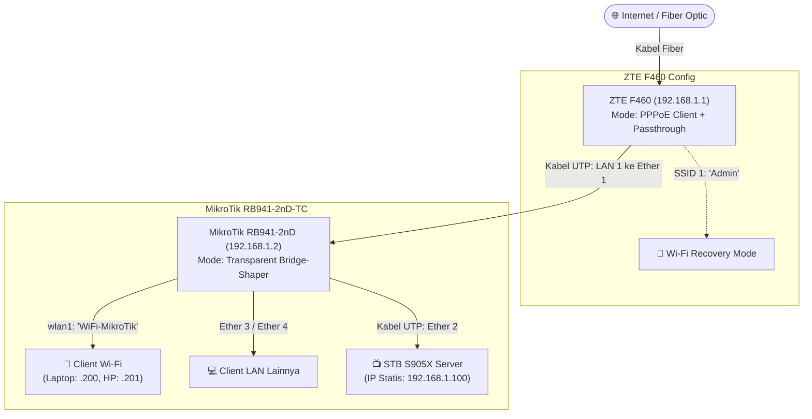

# 🏠 Mini Home Server & Network Infrastructure — STB Amlogic S905X

[](https://www.armbian.com/)
[]()
[](https://www.docker.com/)
[](https://mikrotik.com/)
[]()

Dokumentasi komprehensif rancang bangun infrastruktur jaringan rumah dan mini home server hemat daya berbasis **STB Android TV (Amlogic S905X)** dengan sistem operasi **Armbian Linux**, terintegrasi bersama **Modem ISP ZTE F460** dan router **MikroTik RB941-2nD (hAP lite TC)**.

---

## 📑 Daftar Isi
1. [Bagian 1: Setup Home Server (Armbian, Docker & Immich)](#-bagian-1-setup-home-server-armbian-docker--immich)
   * [1.1 Spesifikasi Sistem](#11-spesifikasi-sistem)
   * [1.2 Instalasi Docker & Compose](#12-instalasi-docker--docker-compose)
   * [1.3 Setup Direktori Server](#13-menyiapkan-folder-server--docker-composeyml)
   * [1.4 Mitigasi Storage & Flashdisk SanDisk 32GB](#14-mitigasi-masalah-storage-pemindahan-docker--immich-ke-flashdisk-sandisk-32gb)
   * [1.5 Anatomi Folder Storage Immich](#15-anatomi-struktur-folder-storage-immich-di-flashdisk)
   * [1.6 Monitoring & Maintenance](#16-pemantauan-sistem--maintenance-rutin)
2. [Bagian 2: Topologi Jaringan & Konfigurasi Perangkat](#-bagian-2-topologi-fisik--konfigurasi-jaringan)
   * [2.1 Diagram Topologi Fisik](#21-diagram-topologi-fisik)
   * [2.2 Konfigurasi Router ISP (ZTE F460)](#22-konfigurasi-router-isp-zte-f460)
   * [2.3 Konfigurasi MikroTik RB941-2nD-TC](#23-konfigurasi-mikrotik-rb941-2nd-tc-hap-lite)
   * [2.4 Konfigurasi IP Statis STB Server](#24-konfigurasi-ip-statis-stb-server)
   * [2.5 Tabel Alokasi IP Address](#25-tabel-alokasi-ip-address)

---

# 🚀 Bagian 1: Setup Home Server (Armbian, Docker & Immich)

---

### 1.1 Spesifikasi Sistem
* **Hardware:** STB Android TV (Amlogic S905X, RAM 1GB / 2GB)
* **Sistem Operasi:** Armbian Linux (Debian / Ubuntu aarch64)
* **Akses Terminal:** SSH sebagai user `root`
* **Internal Storage:** eMMC internal bawaan (< 5 - 6 GB usable)
* **External Storage:** Flashdisk SanDisk 32GB via USB (mount point: `/mnt/sandisk32G`, filesystem: `ext4`)
* **Tantangan Utama:** Service **Immich** membutuhkan ruang besar untuk backup foto/video, sementara Docker secara default menyimpan seluruh file di `/var/lib/docker` internal.

---

### 1.2 Instalasi Docker & Docker Compose

Masuk ke terminal STB via SSH sebagai user `root`, lalu jalankan baris perintah berikut secara berurutan:

```bash
# 1. Update list paket dan perbarui paket sistem yang usang
apt update && apt upgrade -y

# 2. Download dan eksekusi script instalasi resmi dari Docker
curl -fsSL https://get.docker.com -o get-docker.sh && sh get-docker.sh

# 3. Pasang plugin resmi Docker Compose (Compose V2)
apt install -y docker-compose-plugin

# 4. Aktifkan dan jalankan daemon Docker secara otomatis saat booting
systemctl enable --now docker
```

Verifikasi hasil instalasi:
```bash
docker --version && docker compose version
```

---

### 1.3 Menyiapkan Folder Server & `docker-compose.yml`

Seluruh file konfigurasi layanan diatur di dalam direktori kerja `/root/server`:

```bash
# Buat folder server jika belum tersedia
mkdir -p /root/server

# Masuk ke dalam direktori server
cd /root/server
```

**Menyiapkan file `docker-compose.yml`:**
1. Jika kamu meng-clone repository ini ke STB, file `docker-compose.yml` sudah otomatis tersedia di dalam folder.
2. Jika setup manual, buat file tersebut menggunakan editor nano:
   ```bash
   nano docker-compose.yml
   ```
   *(Tempelkan skrip konfigurasi compose, lalu simpan dengan menekan `Ctrl + O`, `Enter`, dan keluar dengan `Ctrl + X`)*.

Jalankan container:
```bash
docker compose up -d
docker compose ps
```

---

### 1.4 Mitigasi Masalah Storage: Pemindahan Docker & Immich ke Flashdisk SanDisk 32GB

#### Bagian A: Persiapan & Mounting Flashdisk SanDisk 32GB Otomatis

Tancapkan Flashdisk SanDisk 32GB ke port USB STB, lalu jalankan langkah-langkah berikut:

1. **Cek partisi flashdisk yang terdeteksi:**
   ```bash
   lsblk
   ```
   > Perintah ini digunakan untuk melihat daftar seluruh media penyimpanan dan partisi yang terdeteksi oleh sistem (misalnya Flashdisk SanDisk terdeteksi sebagai `/dev/sda1`).

2. **Format partisi flashdisk ke filesystem Linux:**
   ```bash
   mkfs.ext4 -F /dev/sda1
   ```
   > Perintah ini digunakan untuk memformat partisi flashdisk ke filesystem `ext4` agar mendukung penuh hak akses Linux dan kompatibel dengan sistem perizinan Docker.

3. **Buat direktori titik pengait (mount point):**
   ```bash
   mkdir -p /mnt/sandisk32G
   ```
   > Perintah ini digunakan untuk membuat folder pengait baru di `/mnt/sandisk32G` sebagai titik masuk penyimpanan flashdisk.

4. **Ambil UUID unik partisi flashdisk:**
   ```bash
   blkid /dev/sda1
   ```
   > Perintah ini digunakan untuk menampilkan kode UUID unik dari flashdisk agar proses pengaitan partisi tidak tertukar meskipun urutan port USB berubah setelah restart.

5. **Daftarkan partisi ke fstab:**
   *(Ganti `PASTE_UUID_DISINI` dengan kode UUID hasil dari perintah nomor 4)*
   ```bash
   echo 'UUID=PASTE_UUID_DISINI /mnt/sandisk32G ext4 defaults,noatime 0 2' >> /etc/fstab
   ```
   > Perintah ini digunakan untuk mendaftarkan konfigurasi mounting flashdisk ke dalam file `/etc/fstab` agar partisi otomatis terpasang ke `/mnt/sandisk32G` setiap kali STB booting.

6. **Pasang partisi langsung tanpa restart:**
   ```bash
   mount -a
   ```
   > Perintah ini digunakan untuk menjalankan mounting seluruh partisi yang ada di fstab secara langsung tanpa perlu melakukan restart perangkat.

---

#### Bagian B: Migrasi Data Docker yang Sedang Berjalan ke Flashdisk

1. **Hentikan service Docker:**
   ```bash
   systemctl stop docker docker.socket
   ```
   > Perintah ini digunakan untuk menghentikan total service dan socket Docker agar tidak ada aktivitas baca-tulis selama proses penyalinan file berlangsung.

2. **Salin seluruh data Docker ke flashdisk:**
   ```bash
   rsync -avP /var/lib/docker/ /mnt/sandisk32G/docker/
   ```
   > Perintah ini digunakan untuk menyalin seluruh images, containers, dan volumes dari folder Docker lama ke flashdisk dengan tetap mempertahankan integritas hak akses file.

3. **Cadangkan direktori lama sebagai arsip:**
   ```bash
   mv /var/lib/docker /var/lib/docker.bak
   ```
   > Perintah ini digunakan untuk mengubah nama folder Docker lama menjadi file cadangan sementara guna memastikan data asli aman sebelum dihapus permanen.

4. **Arahkan `data-root` Docker ke flashdisk:**
   ```bash
   cat <<EOF > /etc/docker/daemon.json
   {
     "data-root": "/mnt/sandisk32G/docker"
   }
   EOF
   ```
   > Perintah ini digunakan untuk mengonfigurasi direktori penyimpanan utama Docker agar berpindah ke flashdisk di folder `/mnt/sandisk32G/docker`.

5. **Jalankan kembali Docker:**
   ```bash
   systemctl start docker
   ```
   > Perintah ini digunakan untuk menyalakan kembali engine Docker menggunakan konfigurasi direktori penyimpanan yang baru di flashdisk.

6. **Verifikasi lokasi `data-root` baru:**
   ```bash
   docker info | grep "Docker Root Dir"
   ```
   > Perintah ini digunakan untuk memverifikasi dan memastikan bahwa path penyimpanan Docker telah berhasil berpindah ke `/mnt/sandisk32G/docker`.

7. **Hapus cadangan lama:**
   ```bash
   rm -rf /var/lib/docker.bak
   ```
   > Perintah ini digunakan untuk menghapus folder cadangan lama di penyimpanan internal eMMC sehingga kapasitas internal STB langsung lega kembali.

---

#### Bagian C: Konfigurasi Penyimpanan Immich

1. **Verifikasi nilai `UPLOAD_LOCATION` pada file `.env`:**
   ```bash
   cat /root/server/.env | grep UPLOAD_LOCATION
   ```
   > Output yang wajib muncul:
   ```env
   UPLOAD_LOCATION=/mnt/sandisk32G/immich-app/library
   ```

2. **Buat direktori target di flashdisk jika belum ada:**
   ```bash
   mkdir -p /mnt/sandisk32G/immich-app/library
   ```

3. **Jalankan kembali service:**
   ```bash
   cd /root/server && docker compose up -d
   ```

---

### 1.5 Anatomi Struktur Folder Storage Immich di Flashdisk

Setelah Immich berjalan, struktur folder otomatis tersusun di dalam `/mnt/sandisk32G/immich-app/library`:

```text
/mnt/sandisk32G/immich-app/library
├── library/
│   └── <admin-user-id>/
│       └── 2026/
│           └── 2026-08-07/
│               └── IMG_0001.jpg
├── upload/         (Folder temporary / bilik upload user saat transfer data berlangsung)
├── thumbs/         (Thumbnail foto/video untuk performa cepat pada aplikasi)
└── profile/        (Foto profil pengguna)
```

* **`library/`**: Penyimpanan permanen foto/video yang tersusun terstruktur per `<user-id>`, Tahun, dan Tanggal.
* **`upload/`**: Bilik transit sementara saat perangkat handphone mengunggah foto sebelum diverifikasi.
* **`thumbs/`**: Menyimpan cache thumbnail resolusi rendah untuk efisiensi RAM STB & loading galeri.
* **`profile/`**: Foto profil tiap akun pengguna Immich.

---

### 1.6 Pemantauan Sistem & Maintenance Rutin

```bash
# Cek sisa storage eMMC & Flashdisk
df -h

# Cek penggunaan resource per container
docker stats

# Cek suhu SoC & CPU STB
armbianmonitor -m
```

---

# 🌐 Bagian 2: Topologi Fisik & Konfigurasi Jaringan

---

### 2.1 Diagram Topologi Fisik



---

### 2.2 Konfigurasi Router ISP (ZTE F460)

Router ZTE F460 difungsikan sebagai modem panggil PPPoE dan gateway jaringan utama (`192.168.1.1`).

#### A. Konfigurasi WAN (PPPoE & Passthrough)
* **IP Mode:** `IPv4`
* **Connection Type:** `PPPoE`
* **Service List / Template:** `TR069_INTERNET_R_VID`
* **Port Binding:** Centang **seluruh port LAN** dan **SSID 1**
* **Username PPPoE:** `anisryan@ak.net`
* **Password PPPoE:** `5758`
* **Option:** Beri tanda centang pada opsi **`Enable Passthrough`**

#### B. Konfigurasi SSID 1 (Recovery Access)
SSID ini difungsikan khusus sebagai jalur darurat nirkabel untuk mengakses WebGUI ZTE F460 langsung tanpa melewati MikroTik jika terjadi kendala jaringan:
* **Enable Wireless RF:** Centang (Aktif)
* **SSID Index:** `SSID 1`
* **SSID Enable:** Centang
* **SSID Name:** `Admin`
* **Security & Password:** WPA2-PSK *(Password ditentukan sendiri)*

#### C. Pengkabelan Fisik
Hubungkan **Kabel UTP** dari port **LAN 1 ZTE F460** menuju port **Ether 1 MikroTik RB941-2nD**.

---

### 2.3 Konfigurasi MikroTik RB941-2nD-TC (hAP lite)

MikroTik difungsikan sebagai **Transparent Bridge Traffic Shaper** (Bridge dengan IP Firewall) untuk mengatur bandwidth manajemen (*Simple Queue*) tanpa melakukan double NAT.

#### 1. Bersihkan Konfigurasi Awal (Factory Reset Tanpa Default)
Buka Winbox, buka Terminal MikroTik dan jalankan:
```routeros
/system reset-configuration no-defaults=yes skip-backup=yes
```

#### 2. Buat Bridge Transparan & Aktifkan Pemantauan IP Firewall
```routeros
/interface bridge add name=bridge-shaper protocol-mode=rstp
/interface bridge settings set use-ip-firewall=yes allow-fast-path=no
/ip settings set allow-fast-path=no
```

#### 3. Konfigurasi Keamanan & Optimasi Radio Wi-Fi Low-Latency (wlan1)
```routeros
/interface wireless security-profiles
set [ find default=yes ] supplicant-identity=MikroTik
add name=profil-wlan mode=dynamic-keys authentication-types=wpa2-psk \
    unicast-ciphers=aes-ccm group-ciphers=aes-ccm \
    wpa2-pre-shared-key="PasswordWifiKamu"

/interface wireless
set [ find default-name=wlan1 ] band=2ghz-onlyn channel-width=20mhz country=indonesia \
    disabled=no distance=indoors frequency=auto frequency-mode=regulatory-domain \
    installation=indoor mode=ap-bridge preamble-mode=short \
    security-profile=profil-wlan ssid="WiFi-MikroTik" wireless-protocol=802.11 \
    wmm-support=enabled adaptive-noise-immunity=ap-and-client-mode
```

#### 4. Masukkan Port Fisik & Wi-Fi ke dalam Bridge
> **Perhatian:** Port `ether2` yang terhubung ke STB Server diaktifkan (`disabled=no`) dan dimasukkan ke dalam `bridge-shaper` agar STB tergabung dalam jaringan lokal:
```routeros
# Aktifkan ether2 untuk koneksi ke STB Server
/interface ethernet set [find name=ether2] disabled=no

# Masukkan port ke dalam bridge
/interface bridge port
add bridge=bridge-shaper interface=ether1 hw=no
add bridge=bridge-shaper interface=ether2 hw=no
add bridge=bridge-shaper interface=ether3 hw=no
add bridge=bridge-shaper interface=ether4 hw=no
add bridge=bridge-shaper interface=wlan1
```

#### 5. Konfigurasi IP Remote MikroTik & Gateway
```routeros
/ip address add address=192.168.1.2/24 interface=bridge-shaper network=192.168.1.0
/ip route add distance=1 gateway=192.168.1.1
/ip dns set servers=192.168.1.1
```

#### 6. Manajemen Bandwidth (Simple Queue Ringan — Hemat CPU)
Menggunakan *queue type* `ethernet-default` agar beban CPU MikroTik RB941 tetap rendah dan tidak menyentuh 100%:
```routeros
/queue simple add name="Laptop" target=192.168.1.200/32 max-limit=41M/41M
/queue simple add name="HP" target=192.168.1.201/32 max-limit=41M/41M 
/queue simple add name="LAN" target=192.168.1.0/24 max-limit=20M/20M
```

---

### 2.4 Konfigurasi IP Statis STB Server

Hubungkan **Kabel UTP** dari port **Ether 2 MikroTik** ke port **LAN RJ45 STB S905X**.

Konfigurasikan IP Statis pada STB Armbian:
* **IP Address:** `192.168.1.100`
* **Netmask:** `255.255.255.0` (`/24`)
* **Default Gateway:** `192.168.1.1` *(IP ZTE F460)*
* **DNS Nameserver:** `192.168.1.1`, `1.1.1.1`

**Cara setting via NetworkManager (Terminal SSH STB):**
```bash
# Cek nama koneksi ethernet yang aktif (misal: 'Wired connection 1' atau 'eth0')
nmcli connection show

# Atur IP Statis, Gateway, dan DNS
nmcli connection modify "Wired connection 1" ipv4.addresses 192.168.1.100/24
nmcli connection modify "Wired connection 1" ipv4.gateway 192.168.1.1
nmcli connection modify "Wired connection 1" ipv4.dns "192.168.1.1 1.1.1.1"
nmcli connection modify "Wired connection 1" ipv4.method manual

# Restart koneksi agar konfigurasi aktif
nmcli connection up "Wired connection 1"
```

---

### 2.5 Tabel Alokasi IP Address

| Perangkat | Interface / Koneksi | IP Address | Keterangan / Fungsi |
| :--- | :--- | :--- | :--- |
| **ZTE F460** | LAN & Recovery Wi-Fi | `192.168.1.1` | Gateway Utama & PPPoE Client |
| **MikroTik RB941** | `bridge-shaper` | `192.168.1.2` | IP Remote Winbox & Webfig |
| **STB S905X** | Port LAN (Ether 2 MikroTik) | `192.168.1.100` | Mini Home Server (Docker & Immich) |
| **Laptop Client** | Wi-Fi / DHCP | `192.168.1.200` | Limit Bandwidth 41 Mbps Simetris |
| **Smartphone** | Wi-Fi / DHCP | `192.168.1.201` | Limit Bandwidth 41 Mbps Simetris |
| **Pool Subnet LAN** | Ether 3, 4 & Client Lain | `192.168.1.0/24` | Limit Bersama 20 Mbps |
